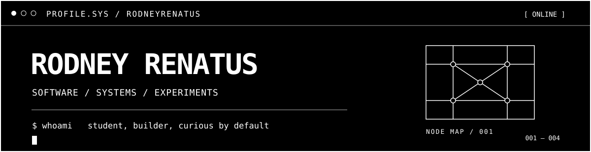
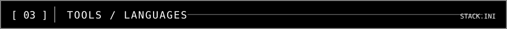

<p align="center">
  
</p>

<p align="center"><code>USER: RODNEYRENATUS / MODE: BUILDING / LOCATION: MALAYSIA</code></p>

<p align="center"><code>Software development student. I build projects to understand how things work.</code></p>

<p align="center"></p>

```text
Interested in software, game development, robotics, and systems built from scratch.
This profile is an index of things I have made, learned, and continue to improve.
```

<p align="center"></p>

```text
[01]  CHESS_C
      A chess game written in C.

[02]  SPACE-SHOOTER
      A two-player space shooter built with Python.

[03]  ZELDA_2D
      A 2D project inspired by The Legend of Zelda.
```

<p align="center">
  <code><a href="https://github.com/rodneyrenatus/chess_c">[ chess_c ]</a></code>
  &nbsp;
  <code><a href="https://github.com/rodneyrenatus/space-shooter">[ space-shooter ]</a></code>
  &nbsp;
  <code><a href="https://github.com/rodneyrenatus/Zelda_2d">[ Zelda_2d ]</a></code>
</p>

<p align="center"></p>

<p align="center">
  <code>PYTHON</code> &nbsp; <code>C</code> &nbsp; <code>C#</code>
  &nbsp; <code>JAVASCRIPT</code> &nbsp; <code>REACT</code> &nbsp; <code>ARDUINO</code>
</p>

<p align="center"></p>

<p align="center"><code><a href="https://github.com/rodneyrenatus">GITHUB.COM/RODNEYRENATUS ↗</a></code></p>

<p align="center"><code>END_OF_FILE / © RODNEY RENATUS</code></p>
